# PySaiyanWeBoo

🌐 [GitHub Pages](https://myon-bioinformatics.github.io/PySaiyanWeBoo/) · 🏠 [Portfolio](https://myon-bioinformatics.github.io/)

<p align="center">
  
</p>

[Icon](https://myon-bioinformatics.github.io/PySaiyanWeBoo/icon.png) · [Favicon](https://myon-bioinformatics.github.io/PySaiyanWeBoo/favicon.png)

Shared CSS themes, semantic UI components, and small browser modules for static interfaces across myon-bioinformatics projects, all built by one standard-library Python module (`pysaiyanweboo.py`) that keeps them as Python data.

**Static-first · build-free runtime · dependency-light · cross-repository**

## Name origin

PySaiyanWeBoo combines Py (Python), Saiyan, Web, and Boo. Like Majin Buu in Dragon Ball Z, it absorbs work from many other repositories and makes it its own. And like a Saiyan, who grows stronger through every battle and every round of training, it keeps getting better with each change and test. It serves all of this together as web pages. It was formerly named web-ui.

## Ecosystem concept

[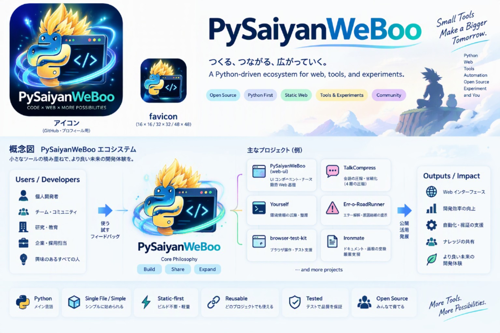](docs/brand/ecosystem.png)

つくる、つながる、広がっていく。小さなツールの積み重ねで、より良い未来の開発体験を。

## v1 foundation

```text
pysaiyanweboo.py the one Python module: CSS (in memory), pages, themes, and shared helpers beyond the web UI
ui.html          the front page: front_document() over the library's own builders, kept equal by a test (nothing is written for the page alone)
                 (example data is Python too: pysaiyanweboo.EXAMPLES, example_data(), --example NAME; no examples/ directory)
                 (the browser modules are Python data too: js_modules(), write_js(); there is no js/ directory)
tests/
```

There are no css/ files and no example HTML files: the stylesheets are Python data (`pysaiyanweboo.css_source()`), the example pages are built by `pysaiyanweboo.example_pages()` (`python -S pysaiyanweboo.py --site DIR` writes them). Modern is the default theme, not the only theme. `github-like` is the first alternate theme using the same semantic `ui-*` / `stub-*` contract.

Generic JavaScript handles browser behavior and rendering helpers. MCP/API protocol semantics remain in consuming repositories.

## Consumer-owned catalog pages

`catalog_document(spec)` builds a script-free page from repository-owned items,
settings and evidence links using the existing shared components. Analysis reports
and project directories use the same entry; data collection and Pages publication
stay with each consumer. [Schema, examples and adoption boundary](docs/catalog-pages.md).

## Python-first flow replacement

Card-style flow diagrams and atomic flow edits now belong to [ascii_artist's accepted Python implementation](https://github.com/myon-bioinformatics/ascii_artist/blob/a9af65cc443e6129176f83268142bff2c2397b66/docs/card-flows.md).
Pin `a9af65cc443e6129176f83268142bff2c2397b66` (or a later tested revision) when migrating: use `validate_flow`, `flow_html`, `flow_mermaid`, `flow_document`, `flow_css`, and `patch_flow` from `ascii_artist.py`.
The CLI routes are `python -S ascii_artist.py flow-cards` and `python -S ascii_artist.py flow-patch`; the existing small CJS entry forwards to the same Python implementation.
`flow_document()` embeds its CSS by default, so it does not depend on the removed PySaiyanWeBoo `css/` paths. The replacement retains card rendering, text escaping, bounded/atomic patch validation and behavioral regression tests; PySaiyanWeBoo no longer maintains a second flow engine.

## Themes

Current themes:

- `modern` — terminal-styled default (text is Meiryo like every theme; code stays monospace)
- `github-like` — generic light presentation intentionally using familiar GitHub visual cues
- `green`, `red`, `blue`, `purple`, `terminal` — candidates, token-only: palettes (green first built by hand in Ironmate's studio; purple is flutter_navigation_basic's Material 3 baseline, kept before that repository is archived; red and blue are `theme_palette(hue)`, and any hue works; terminal is mcp-toolcall-lab's dark terminal-lite returned here, mono body font) whose values are generated into `tokens.css` (no theme files, not in contract v1 yet)

Single-file pages: `render_document(css=bundled_css())` (or `python -S pysaiyanweboo.py --css-bundle`) embeds every
stylesheet and theme, built in memory from the sources in `pysaiyanweboo.py`; nothing is written to the repository. Because all themes ship
together, `bindTheme()` from `ui.js` switches `data-ui-theme` live, with no stylesheet swap and no reload.
In the same way `bindLabels()` switches `data-ui-labels` between emoji faces (the default) and short words, as on a PC: a
control carries both (`data-ui-word="エクスポート"` beside its `📤`), the 💻 To textual ⇄ 📱 To iconic button is `labels_switch_html()` (or a header
row with `key: "labels"`), and rows marked `data-ui-group` get a light dashed line between them, for groups such as create /
update / delete. The choice is remembered in the browser.
A studio's controls are `toolbar_html(groups)`: rows of groups (`[("create", [{act, face, word, words, candidates?, close?, href?}]), …]`,
checked by `toolbar_validate`), each control an emoji face with its short word, and one candidate row that `bindToolbar(root, run)`
(`ui.js`) opens under the pressed row: a candidate runs its own act (`▭` → `rect`), or the button's act with its face (a stamp:
`run("emoji", "🌱")`), and `close` hides the row after the pick (📥 📤 and their formats). A candidate with `accept` (and
`capture: "environment"` for a camera) gets the toolbar's own hidden file chooser: the pick opens it and the chosen File runs
`run("image", file)`, so a page writes no `<input type="file">` of its own; `choose(act)` opens one from the page. Every press calls
`run`; the page decides.
From Node, run `node vendor/py_launch.cjs -- pysaiyanweboo.py --css-bundle`.

🌍 The world (`web-ui-world/1`: [🌍 the travel world](https://myon-bioinformatics.github.io/tools/demos/world.html), 🏫 the school, 🗼 the parallel cities, 🎬 the camera page, the catalogue map) and 🤖🔁 the MCP / API stubs
moved to the portfolio (`scripts/world.py` and `scripts/project_pages.py` in myon-bioinformatics.github.io; the stubs are in its [🧰 Tools](https://myon-bioinformatics.github.io/#tools)): they are
built on these parts and themes, which stay here. `random_theme(seed)` and `--theme-wall N` show seeded random themes side by side.

Seed dial: `theme.js` is Python's own generator written out for the page (CPython's Mersenne Twister seeded as `random.Random(int)` seeds it, the same steps), so
`randomTheme(seed)` gives exactly the tokens `random_theme(seed)` gives (checked on thousands of seeds, negative and 2^53 ones included) and `bindSeed()` wears any seed
live with no reload: `seed_dial_html()` (a slider), `seed_roll_html()` (🎲), a tap on any `[data-seed]` cell of the wall, ✖️ or a named theme (`theme_switch_html()`) to go back.
The seed is remembered in this browser. Python stays the reference; the page never invents a palette of its own.

Front page layout: `front_document(main, rooms, title=...)` is one view that fills the viewport under a 48px bar, and a 🚪 menu of rooms that open over it through `:target`
(no script; ✖️ closes). A room is `{"id", "emoji", "title", "text", "html"}`: add one to put something on the page, improve a builder to improve the page.
`ui.html` (the Pages' front, opened from the usage guide at the top) is exactly that call over the library's builders (🎛️ `theme_switch_html`, `seed_dial_html` and 🎲 `theme_wall` as the main view; 🧩 the example cards, 📋 `curl_panel_html` and 🧭 the way to the portfolio's demos as rooms), and a test
requires every one of their outputs to be in it. `render_document` takes optional `favicon` / `touch_icon` PNG links for such pages.
Generate a browser-only HTML import tool with `html_import_files()`. Write its returned path-to-bytes mapping under a static site directory.
The tool accepts pasted HTML and UTF-8 files, extracts text, headings and links, and downloads JSON. To reuse an existing PSWB asset directory,
pass `shared_base="../vendor/web-ui"`. This emits only `index.html` and `extract.mjs`.

The small face in the center of the header looks toward the pointer or a tap, wanders after 1.5 seconds of inactivity, and blinks when pressed.
Pass `gaze_label="Blink"` to an existing `front_document(...)` call to add the face, its styles and its behavior. With reduced motion enabled it stays still.
The component defaults to the accessible name `Blink`. For a standalone HTML page, call `component_document("gaze-avatar")` or run
`python -S pysaiyanweboo.py --component gaze-avatar > avatar.html`.
For a custom layout, `component_parts("gaze-avatar")` returns the button HTML, CSS and JavaScript as strings.
Place the button wherever needed and include the CSS and module once per page.

`scroll_html(trusted_html, label=, kind="row"|"table")` marks a region that scrolls sideways; `scroll.js` (it binds itself, `bindScroll()`) adds ‹ › buttons, edge fades and, for tables, a second scrollbar on top, and `scroll.css` draws them from the tokens. It came from the parent repository's observatory, so pages do not keep their own copy: `component_parts("scroll", html, label=...)` gives the HTML, the stylesheet and the module from Python.

App shell: `showcase_document(spec)` (`web-ui-showcase/1`, example in `EXAMPLES["showcase"]`, generated as `examples/showcase.html`) builds a header, a
rail (256 px at 1200+, 80 px from 900) or bottom bar (narrower) and sections that switch through radio buttons: no reload, and no script for
switching. Classes `ui-shell*`, `ui-rail*`, `ui-bottom-*`, `ui-icon-button`; the optional favorite button uses `bindToggles` from ui.js (memory only)
and the theme list uses `bindTheme`. It replaces the pinned CSS copy in flutter_navigation_basic's `experiments/ui-showcase-html`.

Coordinates (`examples/coordinates.html`): `parse_coordinate` (full-width digits are read; hex is refused), `try_parse_maps_url` (`ll=`, `query=`/`q=`, the `!3d..!4d..`
place pin before the `@` viewport centre; tried as written, decoded once and decoded repeatedly), `to_dms` with the rounding carry, `tolerance_area` (the box around a
radius, date-line and pole cases), `zoom_for_radius`, `xyz_tile`, `maps_urls` and `area_texts` (JSON, bbox, Google Maps and MapKit snippets, area links), from
flutter_navigation_basic's coordinate tool. Its Dart tests and shared golden vectors (`tests/fixtures/coordinate_area_cases.json`) are the oracle; `coordinates.js` equals
Python on 500+ random areas (every copyable text byte for byte), zooms, tiles and 800 Maps-URL variants. Short-link expansion needs a network and stays out.

📍 `coordinates_html(spec)` makes the same tool a site's own map tool, each part only when asked for (`coordinates_validate`; `None` is the plain tool, byte for byte):

```python
spec = {"id": "map", "point": {"lat": 35.68134, "lon": 139.7665, "label": "東京駅"}, "radius": 100,
        "places": [{"id": "tokyo-station", "label": "東京駅", "lat": 35.68134, "lon": 139.7665, "href": "#cities-spot-station"}],   # a list to pick from, and the places inside the radius
        "pins": "site-map-pins/1",      # 📌 up to 100 points with their names and radii, kept in this browser under this key
        "share": True,                  # open / copy the Maps addresses, the link to this point (?lat=&lon=&name=&radius_m=, read on load), a text to share
        "words": {"title": "📍 地図URL・座標ピン留め", "pin": "📌 ピン留め", "radius": "半径: {n} m"}}   # any word of the markup or of coordinates.js; the rest stays English
page = pysaiyanweboo.coordinates_document(spec)          # or component_parts("coordinates", spec) with add_part
```

A place's `href` that is a `#fragment` of this page keeps the point in its address, so the page it opens can read it back. `coordinates.js` also exports
`distanceMeters`, `checkedPin` and `pointLink`.

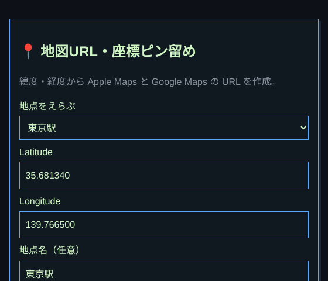

🗓️ 2026-11-28 · `PSWB_GIFS=docs/evidence uv run --locked --group world-test python tests/integration/pages_browser.py CoordinatesBrowserTests` writes `component-coordinates.gif`.

Photo studio (`examples/photo-studio.html`): frames and stamps on a photo, all in the page and in memory. Python is the reference: `photo_sniff` (PNG, JPEG, WebP, GIF, AVIF, HEIC
from the magic bytes; JPEG progressive and EXIF Orientation 1-8 with the marker scan that skips an XMP block and fill bytes), `photo_header_size` (the width and height a PNG, GIF,
JPEG or WebP header declares, read without decoding, so the 40-megapixel budget is checked before any engine decode), `photo_decide` (Flutter's order: a declared type that is not
`image/*`, empty or over 32 MiB, the budget, the engine decode, the budget again; HEIC that cannot be decoded says so), `photo_document_size` (two thirds, long side at most 4096),
rectangles and shapes (`photo_rect_*`, `photo_shape_contains`, `photo_describe`, hit targets), `PhotoHistory` (20 steps, gestures as one step) and `PhotoStudio` (drag to create,
move, resize, stamps, spray, undo) as one state machine, from flutter_navigation_basic's `lib/features/photo_studio`. Its Dart tests and `import_compat` fixtures are the golden
values (`tests/fixtures/photo_import_cases.json`, bytes copied unchanged with their sha256 and the outcome Flutter measured for each), and Pillow is the independent oracle for sizes,
orientation and progressive flags. `photo.js` equals Python exactly on 1,500+ damaged and generated files, 1,500 import decisions, 600 random rectangles and 90-step random
edit sessions (about 10,000 steps compared state by state); a mutation in any rule fails those tests.
**Platform differences absorbed.** EXIF Orientation is neutralised in the bytes (two bytes) and the page turns the picture itself with `photo_orientation_matrix`, so engines that turn
EXIF pictures on their own and engines that do not draw the same upright pixels (the page's pixels equal Pillow's `exif_transpose`); the blob is given the type the bytes show, not the
one the file claims; pointer events with `touch-action: none` and a pointer capture, so a finger edits the canvas instead of scrolling the page; the canvas is kept under 16 million
pixels; the PNG is saved with `a[download]` (opened in a tab where that is missing) and shared where `navigator.canShare` allows. **What is not claimed.** "Check this browser" decodes
nine tiny pictures and reports, as JSON shaped like the Flutter app's `evidence/*.json`, what *this* browser decodes (`loader_browser_canvas_adapter`) and whether it turns EXIF pictures
itself. Chromium results are measured here; Firefox and WebKit run in CI; iOS Safari (HEIC, camera, Share, `download`) is **not verified** until the page is opened on a device and
its JSON is kept; a browser emulation is not a device (see the platform notes below).

Successor tools (`examples/play-studio.html`, `examples/timeline.html`): seeded Counter garden,
reusable reward stamps, Irony quest, replay/test-input export, and dated appointments sorted
by explicit UTC instants with IANA zone labels. [Setup and migration inventory](docs/flutter-successor-studios.md).

Current item (`examples/current-item.html`): `current_items_html` renders an ordered list and
`setCurrentItem(list, index)` from `current-item.js` marks a zero-based position with `aria-current="step"`.
Pass `null` to clear it. Use it for a review workflow, a preview queue or the active section of a song.
The caller supplies the position. Styling is in `current-item.css`.

`startTask(run, {timeoutMs})` from `async-task.js` runs an operation with an `AbortSignal`.
The returned `promise` settles on completion, cancellation (`AbortError`) or expiration (`TimeoutError`).
Call `cancel()` when replacing a request or leaving the page. The operation can check its signal
between steps when the browser API it calls cannot itself be interrupted.

`studio_document()` and the original Flutter music APIs remain available to existing callers and the
migration regression suite. The public example gallery uses the current-item demo.
The [standalone metronome and composition demo](https://myon-bioinformatics.github.io/PySaiyanWeBoo/examples/composition-studio.html)
is still available by direct link.

Door-to-Door and emoji transitions (`examples/door.html`): `door_validate` keeps one emoji per page (variation selectors and spaces do not count, so `🗺️` and
`🗺` collide) and only safe targets (a relative path or an http(s) address); `emoji_path("🏠 → 🗺️ → 🌍 ↔ 🕶️", pages)` expands `A → B` (go) and `A ↔ B` (go and come
back) into the hrefs visited, and an unknown emoji returns nothing at all; `door_options` orders the pull-down as Home, the drawn discoveries, then the rest.
The draw is seeded (`mulberry32`, `door_draw`): the same seed draws the same pages in Python and in the page (`door.js`), checked bit for bit in Chromium.
A listener on `ui-door-leave` can cancel a trip (a "really leave?" guard) without a dialog.
`door_html(spec, compact=True)` is the pull-down alone, as one 56px row (🚪 and the select) for a page's header or footer; the same `door.js` binds
it. After the browser's own way back the pull-down shows the current page again, so the same door opens twice.
`door_html(spec, foot=True, links=[{"emoji", "label", "href"}], size=True)` is that row as the page's foot (`.ui-door-foot`, it stays at the window's
foot): 🚪 and the pull-down, the links as icons (another site's opens apart) and 📦 the page's HTML size, which `stamp_page_size(page)` writes.

Clipboard shelf (`examples/clipboard-shelf.html`): paste text, a URL, Markdown or a Base64 image into a shelf that lives in the page only (no storage, no
requests; a reload empties it). Python is the reference: `shelf_classify`, `markdown_plain`, `looks_like_image`, `decode_image_text` (strict: PNG, JPEG,
WebP by their first bytes, a declared type must agree, URL-safe Base64, `%3D` and missing padding are refused, 32 MiB cap), `build_prompt` (the prompt
workbench) and `shelf_bundle`. `shelf.js` gives identical answers; Chromium checks it on Ironmate's 19 Base64 cases
(`tests/fixtures/base64_bridge_cases.json`, Ironmate@56020aef) and on seeded fuzz. Filtering and ordering are radio buttons, so they are CSS.

Clipboard loops (cut, paste, copy back, repeat), on the shelf page and the photo studio: the shelf takes text, images from a file, a drop, a paste or Base64, keeps at most 20
items and 32 MiB (Ironmate's budget; Flutter had none; the page checks again when a slow read finishes) and drops a read that a Clear overtook. `clipboard_pick` reads the
system clipboard in Ironmate's order, with injected `read_text` / `read` so every case is testable: image text first (an invalid `data:image` or an image signature is an
error, never a stale older image), then the first PNG, JPEG or WebP item (a denied text read does not stop it; an oversized item is never read), then (shelf only) plain text;
the failure is one of `clipboard-unsupported`, `-denied`, `-invalid-image`, `-read-failed`, `-no-image`. Ironmate's 35 scenarios (`tests/studio_clipboard.cjs`) are the golden
values, and the same code in `shelf.js` and `photo.js` equals Python on them, on damaged texts and on the 32 MiB boundary (raw, URL, binary, over by one byte). The
temporary clipboard (`session_clip_save`, from Flutter's `SessionTextClipboard` and its Dart tests): 30 entries, 100,000 UTF-16 units each (an emoji counts 2), a repeat moves
to the top. It lives in the page, so a reload empties it and, with no storage, it does not follow you to another page (Flutter kept it while you navigated). The photo studio's
`Paste photo` uses the same reading order, and `Copy as Base64` hands the exported PNG back as `data:image/png;base64,...` or plain Base64, which the shelf reads back byte for
byte (`png_base64_text`). The Image studio below takes in Ironmate's image editor: it reads photos the same way, and what it exports comes back to the shelf unchanged.

Playground (`examples/playground.html`): the Counter Playground, its hold-to-repeat button and the Irony generator, from flutter_navigation_basic's `counter_playground`,
`hold_repeating_button` and `irony_generator`. `counter_apply(state, action, value)` is the controller as a pure function (clamped to -100..100, steps 1, 5 and 10, a history of the
eight newest values, a move that changes nothing leaves the burst token alone, `undo` returns to the next value and records nothing); `counter_effect` / `counter_label` /
`counter_status_key` are the orb strip (at most six), the line under it and the seven-step status text. `hold_repeat_count(held_ms, buttons=)` is the hold rule: nothing for 350 ms, then once,
then every 70 ms, primary button only, and the click after a hold is swallowed once. The irony card: `irony_next` never returns the one on screen (Dart's pick among the other
`n - 1`, skipping the current index), and `irony_drop(arena, card, handle)` decides what a drag does from three rectangles: the card entirely outside the arena (edges that only touch
do not count as inside) spawns the next message, otherwise the whole handle plus 8 px of padding must be inside or the card moves by the least that brings it in (a handle as large
as the arena is centred). The Dart tests are the golden values; `playground.js` equals Python on seeded action runs, 3,000 random drops and every counter from -105 to 105, and
Chromium drives the page (mouse, a fake clock for the hold). Deliberate differences: the random pick uses the Door's seeded `mulberry32` (Dart's `Random(7)` cannot be reproduced),
and a "New irony" button gives keyboard users what only the drag gave. The probe's two adapters are `web-ui-playground` (the counter) and `web-ui-irony`; the second opens at its
heading because the probe wants everything on the first screen.

Test reports (`examples/test-report.html`): the JUnit and test-runner tools of flutter_navigation_basic (`outcomes`, `flutter_machine_junit`, `validate_runner_junit`, `junit_history`,
`failure_identity`, `multi_test_runner`, `node_test_runner`, `expected_child_failure`), in the one file. `junit_report(xml)` reads a JUnit report **failing closed** (missing or malformed XML,
a root that is not a testsuite, no testcase, a testcase without a name, a DTD or entity declaration, over 1 MB), finds testcases at any depth (Node nests `describe()` blocks), and counts
`passed / failed / skipped / xfailed / xpassed / error` (a `skipped` that says `known:` or `xfail:`, or has type `pytest.xfail`, is an xfail); a failure carries the SHA-256 of its message,
not the message. `flutter_outcomes(events)` tallies the Flutter JSON reporter the same way and `flutter_machine_junit(events)` converts it to per-case JUnit (hidden loading tests dropped, a
failed load kept, `classname` is the suite path, anything incomplete is an error). `junit_failure_records` / `junit_history` / `junit_diff` give a failure its identity (class, test with the
parameter suffix removed, kind) and say what is new, recurring or resolved between two runs; `failure_ledger_update` and `attempt_history` keep fingerprints and the "a retry never masks
the first failure" record; `runner_command`, `run_test_suite` and `node_test_run` are the allowlisted Deno / Playwright / Node runners (no shell, files inside the repository, stale reports
removed first, a missing or all-skipped report fails closed); `expected_child_failure` runs a command that is *meant* to fail and keeps bounded evidence. The command line:
`pysaiyanweboo.py --junit FILE... [--previous FILE]`, `--flutter-events FILE [--to JUNIT.xml]`, `--run-tests RUNNER --test-file F`, `--expect-exit CODE --output-dir DIR -- command`.
The Python tests of those eight tools are the golden values (ported case by case); `report.js` equals Python on 900 Flutter event streams (a third of them damaged), about 800 JUnit documents
(generated, damaged and hand-picked: namespaces, CDATA, comments, entities, a DTD, the 1 MB edge, 250-emoji names) and seeded history and ledger runs; its SHA-256 is the page's own
(no `crypto.subtle`, which needs a secure context) and equals `hashlib`. Deliberate differences: a failed, non-hidden `loading <file>` test is an `error` (the tally used to skip
every loading test, so a compile error looked like zero tests); `ok` needs a passed test (nothing ran is not green); a boolean is never an ID and only JSON `true` is a flag (the page
cannot tell `1.0` from `1`); only strings are names, reasons and error text; messages never contain the input; characters XML 1.0 cannot carry are written as U+FFFD; a missing class is
`(none)` in an identity (the originals refused the whole report). The BTK adapter is `web-ui-test-report`.

MCP lab (`examples/mcp-lab.html`): flutter_navigation_basic's `lib/shared/mcp` and the mock server's routes (`build_tools/src/mock_mcp.dart`), as an MCP server that lives in the page
(nothing is sent). `McpFoundation` is the dual-era demo server as a state machine: legacy `2025-03-26` (`initialize` opens a session, `Mcp-Session-Id` after it) and current-official
`2026-07-28` (`server/discover`, no session, `_meta` on every request, results carry `resultType` and lists `ttlMs` and `cacheScope`); `echo`, `demo://readme`, `greet`. `McpRoutes` is
the HTTP layer with its status rules (400/404 for a missing or unknown session, 400 for a request that does not match its `_meta`, 404 for an unknown current-era method but 200 for a legacy
one, 202 for an accepted notification, 403 for an Origin that is not listed, 401 or 403 for a Bearer, 405 for a GET) and the OAuth discovery documents; `McpClient` checks everything it
is told (well-formed JSON-RPC, the id it sent, a non-2xx is never success, no session is kept from a failure) and runs both echo demos; `mcp_validate_modern` is the header/body check in the
Dart order. The helpers: `mcp_header_encode/decode` (a header name that is not printable ASCII travels as `=?base64?...?=`, checked strictly), `pkce_challenge_s256` (RFC 7636 Appendix B is
the oracle), `oauth_server_metadata` / `oauth_resource_metadata` (a server's silence is never read as a promise), `bearer_inspect` (expired is reported before a wrong audience; the signature
is not checked), `rpc_response_parse`. The Dart tests are the golden values (ported case by case); `mcp.js` answers every request of 120 seeded scripts (8,400 requests with damaged
envelopes, headers, Origins and Bearers) exactly as Python's server does, and equals it on the client's handling of 26 canned replies, 800 header names, PKCE, session ids, Bearer
tokens and OAuth documents. Deliberate differences: ids and verifiers come from an injected random source (Dart's `Random(42)` cannot be reproduced; the default is the OS's), the
Bearer clock is in seconds and `Authorization` splits on ASCII whitespace, and the page cannot tell `-32603.0` from `-32603`. The in-process transport of the Dart repo (session errors as
400 and 404, no Origin, no Authorization) is `mcp_foundation_transport`. The Digest/HMAC auth matrix is a separate mock and is not part of this. BTK adapters: `web-ui-mcp-lab`, `web-ui-mcp-send`.

Patterns (`examples/patterns.html`): flutter_navigation_basic's 792 patterns and the processing behind its data-processing ones. The catalogue (`pattern_catalogue()`, 198 patterns in each of
navigation, API, UI/theme and data processing: id `A001`...`D198`, title from the pattern's README, theme from `PATTERNS.md`) can be searched (`pattern_find`: NFKC, case-folded words in the id,
title or theme, plus category and family). For the data-processing patterns it also says who owns each in the original (`pattern_owner`, the rules of its responsibility audit: Python, JavaScript,
Flutter-native, undecided) and which reference here implements it (`pattern_family`). The navigation, API and UI patterns are Flutter screens: they are catalogued, not reimplemented.
The references are the fourteen Python oracles (`collection_query_patterns`, `search_patterns`, `pagination_patterns`, `scoring_heap_patterns`, `state_reducer`, `conversion_patterns`,
`validation_patterns`, `workflow_patterns`, `collection_transform`, `list_selection`, `list_ordering`, `text_processing`, `collection_window`, `collection_structure`) and the five JavaScript ones
(`future_patterns`, `stream_patterns`, `concurrency_patterns`, `event_loop_patterns`, `interaction_patterns`, patterns 4, 35 and 121-150) as `pattern_run(family, request)`, one JSON request in
and one JSON result out, or a `ValueError` with the original's text: `query` (stable sort, named comparators, group, facet, tag, range, haversine radius), `search` (tokenize, a suffix stemmer,
history, fuzzy, autocomplete, highlight), `page` (offset, and cursors bound to the SHA-256 of the exact dataset), `score` (TF-IDF, min-heap), `reduce`, `convert` (NFC/NFKC, strict coercion,
dates, units, UTF-8/Base64, masks), `validate` (a named-regex allowlist, never a user pattern), `workflow` (swap, move, sorted insert, undo/redo with a discarded redo branch, batch, saga rollback,
pub/sub, CQRS, checkpoints), `transform` (a typed schema, `true`, `1` and `1.0` kept apart), `select`, `order`, `text`, `window`, `collection`, `structure`; and `future` (Promise basics, all, race,
timeout), `stream`, `concurrency` (queue, semaphore, mutex, cancel, progress), `event_loop` (sync, microtask, promise, timer) and `interaction` (`pattern_virtual_window`, a debounce through
`PatternDebouncer` on a virtual clock). The JavaScript ones are modelled without a clock: a task has a delay, and what finishes first is a sort on (delay, creation order), as Node's timers do
(0 ms waits 1 ms, a tie goes to the earlier created); numbers read as JavaScript reads them (`1.0` is the integer 1). `python3 pysaiyanweboo.py --pattern FAMILY` runs one on stdin (`list`, `catalogue`;
NaN, Infinity and numbers beyond the float range are refused). The golden values are the originals' own outputs, never this code's: the 34 files of `assets/data_processing/` that the Dart app
shows are reproduced exactly (`tests/fixtures/pattern_assets.json`), and 1,145 requests recorded from the originals (the Python oracles, and the Node modules for the JavaScript five), answers and
refusals with their text, are reproduced exactly (`tests/fixtures/pattern_golden.json`, taken at 39d659e); during development every family was also run against the originals themselves on
seeded requests (3 x 4,000 per Python family, 1,500 + 3,000 per Node family), with no difference once the timers of one request are kept from mixing with another's. Deliberate difference: where an original crashed with a
`TypeError` (an unhashable `operation`, say) this raises `ValueError`; where it would leave a task promise unhandled, the page's copy handles it. `patterns.js` runs nineteen families in the
page (the seventeen above, and `screen` and `native` below): the sync ones answer 1,200 seeded requests per family like Python, refusal text included, and the five JavaScript ones run on real promises and timers (a virtual clock in the tests) and
answer 700 seeded requests each; every cap is tried at its edge in both languages. `search`, `convert` and `validate` stay in Python because they rest on CPython's case folding, integer parsing
and `urlsplit`, and so does TF-IDF (the min-heap runs in the page), and so does `contract` (below); the static page shows what Python answers to their examples, and the page that
`python3 pysaiyanweboo.py --pattern-serve` serves runs them in Python (see the bridge below). Limits of a page: JSON cannot tell `1` from `1.0` (an integral number
is an int), integers beyond 2^53 are not exact, and the catalogue search lower-cases where Python case-folds. The Flutter-native patterns (136-137, 151-175, 183-184) and the screens of every pattern are the next section. Not absorbed: the 594
`view.dart` files of the navigation, API and UI patterns (the inventory detects one shared heuristic shape across all three categories; this does not prove behavioral equivalence or completed migration) and the Digest/HMAC auth matrix mock (not yet).
BTK adapters: `web-ui-patterns`, `web-ui-pattern-run`.

Screens (`examples/screens.html`): the 198 numbered screens of flutter_navigation_basic, its Hub and the native examples. A screen is data (`screen_row(n)`; `tests/fixtures/screens_asset.json` is
assets/screens.json byte for byte): one pattern from each of the four categories, a domain (18, in blocks of eighteen), a use case, and for the 22 integration and auth screens a design note (purpose,
when, three points, a pitfall, a snippet). One of eleven templates draws it (`screen_template`, from the id), the chrome texts come in 11 locales (`screen_text`, 59 keys, golden against
assets/display/app_text.json), and `screen_view(n, locale, state)` returns the whole screen as data: title, chips, tabs, body, use case, links to the pattern's sources and to the references here
(`screen_links_view`; screens 91-99 and 103-110 show those as well). The Hub is `screen_hub(locale, query, mode)` (list or grid, a search over the catalogue with the original's rules), and
`screen_step(n, state, event)` is the state machine of one screen (input, tab, template switch). The native examples of patterns 136-137, 151-175 and 183-184 are `native_initial`, `native_step`,
`native_view` and `native_parallel`: counters and notifications as the Flutter API counts them, and the parallel pattern 136-137 in a Web Worker where Dart uses an Isolate; each card on the Hub page has the address `#native-N`. `screens.js` gives the same
answers (`screen` and `native` are families of `pattern_run` and run in the page); Chromium checks the Hub, every template in several locales, the native examples with real mouse drags and a long
press, the search text and count across resizes from 1180 to 320 px (the original's Screen6 specs), and tap targets of 40 px (24 px for checkboxes). Deliberate differences: Flutter widgets are semantic HTML,
the screens' data and texts are embedded in the page (no load-error state), screen 5 (the URL-parameter tool) is its generic screen with a note, and the native examples count notifications and rebuilds,
which the Dart ones do not display. BTK adapters: `web-ui-screens`, `web-ui-native-patterns`.

Contracts (`pattern_run("contract", ...)`, `python3 pysaiyanweboo.py --pattern contract`): flutter_navigation_basic's `metadata_contracts.py` (the 198 screens and the eleven locale tables),
`header_contracts.py` (measured box geometry: inside the viewport, aligned on one row, stacked with a minimum height) and `gesture_paint.py` (a swap of two cards judged on saved PNGs: exact RGBA
comparison with changed pixels, ratio, bounding box and largest difference). `operation` is `screens`, `locales`, `layout` or `swap`; the answer is `{ok, failures, ...}` (at most 50 reasons, `truncated`
counts the rest), and a request that is not a well-formed measurement is a `ValueError`. Python only: a page cannot decode a screenshot the way a Playwright run saved it, and these are checks that a
test or CI runs. The oracle is the original itself: `tests/fixtures/contract_golden.json` holds the verdict and the messages of the originals on seeded mutations of the real data (and the hash of each
mutated document), taken at ae3c4cb; `python3 tools/contract_golden.py CHECKOUT --check` regenerates it from a checkout and compares.
Deliberate differences: every failure is listed, not the first; `count` allows a smaller catalogue; locale placeholders must equal English's for every key; the header's title-emoji identity belongs to Flutter's
shared header and is left out; PNGs are decoded by `studio_png_decode` (8 bits, not interlaced, at most 4 MP); a bool where a number is wanted is refused.

Bridge (`python3 pysaiyanweboo.py --pattern-serve [--port N] [--allow-origin ORIGIN]`): flutter_navigation_basic's `validation_http.py` (a loopback HTTP server that runs a reference), for every family.
It serves the patterns page at `/` with its Run box wired to `POST /pattern/FAMILY` (a JSON request in, the result out, `{"error": text}` with 400 for what the command line refuses), so `search`,
`convert`, `validate`, `contract` and TF-IDF run in Python from the page. It binds 127.0.0.1 only; the Host must be `127.0.0.1:PORT` or `localhost:PORT` (a name that resolves to loopback is refused:
DNS rebinding), a browser's Origin must be the bridge's own or one given with `--allow-origin` (an origin, no wildcard; the answer echoes that one origin with `Vary: Origin`, and the Private Network
Access header is sent only to it), the body must be `application/json` with a Content-Length of at most 64 KiB (415, 411, 413; 408 when it never arrives), nothing is logged, and a failure inside a reference
is `500 internal error` without its text. Chromium checks the page against Python on seeded random requests (answers and refusals), that a family the page runs itself is never sent, an unreachable bridge, a
late answer or failure that must not overwrite a newer one, no cookies or referrer, and that a page of another origin, a form post and a rebinding host get nothing.

Image studio (`examples/image-studio.html`): Ironmate's image studio (`studio/core.js`, `studio.js`, `image_studio.py`, `docs/image-studio.md`) with Python first. A scene (`ironmate-image-studio/1`: rect, ellipse,
triangle, text, image, heatmap, arrow and clock layers, at most 100 layers and 4 MP, 64 to 4096 px a side) is checked by `studio_validate` (the originals' refusal text, in Japanese, kept word for word), drawn to SVG by
`studio_svg` (the one function the page, its exports and the command line all draw with), and kept in `StudioHistory` (40 states; an edit that changes nothing is not recorded) and in a workspace file
(`studio_workspace_text`, `ironmate-studio-workspace/1`, every state with its images, at most 32 MiB of UTF-8). Around them: the five-stop heat colour with optional levels, `studio_matrix` (a numeric matrix or a Plotly
heatmap trace into heatmap data: row 0 on top, `null` kept as a gap), the alpha-weighted mosaic (`studio_mosaic_rgba`, always recomputed from the kept original, never from a mosaic), arrow geometry, output size
(0.25 to 8 times, at most 8192 px a side and 16 MP), the PNG payload for Base64 hand-off, and a small PNG reader and writer (`studio_png_decode`: 8 bits, not interlaced, every filter and colour type) so the command line
can mosaic photo layers. `studio_place`, `studio_text_layer`, `studio_matrix_layer`, `studio_image_layer`, `studio_demo_scene` and `studio_stamp_demo_scene` are what a click or a button puts on the canvas. Command line:
Heatmap layers may carry an optional `palette` array of 2–256 `#RRGGBB` stops in display order. Stops are evenly spaced; reverse the array to reverse the scale.
Without `palette`, existing scenes use the original five-stop scale. Other browser tools can use `js/heatmap-color.js` (`heatmapColor(value, low, high, levels, palette)`)
without loading the editor. Python callers can use `studio_heat_color` with the same arguments. The grid of Ironmate's browser tools (dot art) is here too, Python first: `pixel_grid_validate`, `pixel_grid_resize` (nearest neighbour), `pixel_grid_svg`, `pixel_grid_header` and `pixel_grid_png` (the same bytes for the same grid; its header as a `tEXt` chunk), with `base64_length` (the characters a file takes as Base64); `js/pixel-grid.js` is the same functions for a page and is checked against Python on random grids. Two images are compared in numbers one can work out by hand (Ironmate's `image_compare` and `studio_image_quality`): `image_error` (colour and alpha error, pixel for pixel), `image_blend`, `image_foreground`, `image_edge_energy`, `image_translate`, `mask_overlap` (IoU, Dice, near misses, edge-weighted Dice) and `image_compare` (overlap, channel similarity and, reported apart, the shift that overlaps best); an image is `(width, height, RGBA bytes)`, what `studio_png_decode` returns. None of them judges how an image looks to a person. Many images with a status each become one small page (Ironmate's `image_digest`): `image_digest(spec, images)` returns the page (a table of rows x columns, every image a thumbnail inside the file, shrunk until the page fits `max_bytes`), a Markdown summary for a pull request and what was done; `image_digest_validate`, `image_digest_html`, `image_digest_markdown` and `image_thumbnail` are its parts. A status only colours and counts; nothing reads it from the pixels. A small, safe part of SVG is drawn to pixels with the standard library alone (Ironmate's `svg_raster`): `svg_rasterize(svg, width=None)` returns `(width, height, RGBA bytes)` for `<rect>` (exact area), `<circle>`, `<ellipse>`, `<polygon>` (4 x 4 samples a pixel), `<g>` with a translate and solid fills, and refuses the rest with `SvgError` naming the element or attribute (paths, strokes, text, gradients, CSS, scripts, images, a DOCTYPE); what `pixel_grid_svg` writes comes back as the grid's own pixels. A still picture becomes a zoom for `encode_gif` (Ironmate's `png_zoom_gif`; needs Pillow): `zoom_shots(png, anchors=["↙️", "🎯"])` goes into each anchor of `ZOOM_ANCHORS` in turn and back out the same way, the whole picture and each peak held; `GifCamera.zoom` is the same zoom on a live page. Several scenes are one deck (Ironmate's slide studio and 📱 phone slides): `slide_deck_validate` (1 to 20 scenes of one size, a title), `slide_deck_text` and `slide_deck_parse` (the saved JSON), `slide_template` (a title and a body; a deck from pages of text is one `slide_template` a page), `slide_deck_edit(deck, "add" | "duplicate" | "delete" | "up" | "down", page)` and `slide_layer_native` (which layers a slide file can keep as shapes). 🏭 The ability to build a studio: `slide_deck_pptx(deck, shell, image_for_layer)` writes the deck as a PPTX in which text (bold, italic), rectangles, ellipses, triangles and arrows stay editable and any other layer is a PNG the caller draws; `shell` is the empty package the slides go into (the consumer's), and `zip_stored` packs it (no compression, one fixed date: the same files give the same bytes). This writer is the one place the library assembles Office XML. `js/slide-deck.js` is the same for a page, `slideDeck(core, shell)` on `js/imagestudio.js`, checked against Python byte for byte on random decks. Python and a page without a canvas measure text alike; a browser measures real glyphs, so a wrapped line may break elsewhere there. The pages of Ironmate's studio itself (image studio, browser tools, slide studio, 📱 phone slides) are drawn by `css_source("studio-pages.css")`: their layout as Ironmate draws it, every selector under its `data-page`, every colour a theme token (only the picture's checker and the white slide keep theirs), so the pages read under every palette, light or dark.

`python3 pysaiyanweboo.py --studio-render FILE [--format svg|json] [--scale N]`, `--studio-heatmap FILE` (a matrix into an editable scene) and `--studio-base64 FILE [--data-uri]`, each with `-o FILE` (never replaces a file
without `--force`); a bad input is exit 2 with a message. The golden values are Ironmate's own `core.js` run by Node, never this code: 1,859 results (`tests/fixtures/studio_golden.json`, taken at Ironmate 3b7c07d) cover every
function on seeded scenes and on the cases of Ironmate's own tests (`test_image_studio.py`, `studio_workspace.test.cjs`), each limit at its edge, each rule of the text breaker, both of its demos (ids aside) and 471
sines and cosines; during development the Python port was also run against `core.js` itself on random scenes (5 x 2,500 per function) with no difference. `imagestudio.js` gives the same answers in the page: Chromium
checks the recorded values, 250 random scenes (SVG text compared to Python's), 400 damaged scenes (same refusal text), the layers a click places (key order too), random histories, workspace text, mosaics and every limit,
and then the editor itself: each tool places its layer where the canvas was pressed, a layer is selected, moved and resized by pointer and arrow keys, the inspector refuses what the scene refuses, a photo is added, kept
exactly and mosaicked from the original (pixels equal to Python's), Base64 and clipboard images, PNG, SVG, Base64, JSON and workspace files are written and read back, and the page fits a 320 px phone. Deliberate
differences from the originals: wrapped text breaks at the same places in every browser and in Python, so the Japanese dictionary of `Intl.Segmenter` is not used (a Han or Hiragana character stands alone, Katakana runs
together; Latin, Hangul, emoji and the rest follow ICU, checked against it on every assigned code point and on 120,000 random strings); text is measured with the installed fonts in the page and with a fixed width estimate
(0.65 em for printable ASCII, 1 em otherwise) in Python and the command line; the clock's hands use fdlibm's sine and cosine written out in both languages, so the SVG text does not depend on the engine; a text stamp's
name takes twelve characters, not twelve UTF-16 units; JSON is read as JavaScript reads it (every number a double). Not absorbed: the slides and PPTX tools, the pixel-art tools and Ironmate's own shelf dialog (the clipboard
shelf is `examples/clipboard-shelf.html`). BTK adapters: `web-ui-image-studio`, `web-ui-image-stamp`.

curl import: `parse_curl(text)` reads a curl command (the editor's subset: `-X -H -d --data-urlencode -u -G -I -A -e --url`, quoting, line continuations,
full-width characters) into method, URL, headers, query, body mode and form fields, with credentials marked `sensitive`; `mask_curl` shows them
as `***`. It never runs curl or sends anything, and error codes never contain the input. The page's `curl.js` (front page, "Request draft")
reads it the same way: Chromium checks it against Python on flutter_navigation_basic's 47 golden cases (`tests/fixtures/curl_request_cases.json`,
copied from its `python/fixtures/` at 39d659e) and 1,500 seeded inputs.

Source panel: `source_panel_html(spec)` is a name box (**Fetch**, **Open JSON**) plus a paste box (**Extract**) that turn one JSON response into Markdown tables, read through a
declarative `spec` the consumer owns (name pattern, one `https://…{name}` address, a title and table layout; see `docs/source-panel.md`). Python is the reference
(`source_spec`, `source_name`, `source_url`, `source_extract`, `source_markdown`); `source.js` and `_CSS["source.css"]` are Python data like the other modules, so a consumer
writes no JavaScript or CSS of its own. Fetch sends one GET per press and never retries; every failure is a message, and pasting needs no network. Chromium checks the page offline
and over HTTP (`tests/integration/pages_browser.py`); `tests/fixtures/source/cases.json` runs through both languages.

`ui.js` (`js_source("ui.js")`) is the shared helper module: `setText`, `prettyJson`, `copyText` (with a fallback where the async
clipboard is missing), `bindTheme`, `bindLabels`, `observeLit` (marks on-screen elements with `data-lit`) and `bindLightbox`
(click-to-enlarge in a `<dialog>`). Import only what a page needs.

Theme files are presentation-only. Consumers keep the same semantic HTML and
switch `data-ui-theme` plus the loaded theme stylesheet.

Typography is shared, not per theme: `--ui-font` (Meiryo, メイリオ, then `sans-serif`) for text and
`--ui-font-mono` for `pre`, `code`, `kbd` and `samp`. The code rule is `!important` so it also wins over
an adapted page's own `pre, code { font-family: inherit }`. No font file is bundled (Meiryo cannot be
redistributed), so systems without it, such as macOS, iOS and Linux, fall back to their `sans-serif`.
`plotly_figure` defaults `layout.font.family` to `pysaiyanweboo.UI_FONT`, the same stack; a figure's own
`layout.font` keys win. PPTX output already defaults to `Meiryo`.

The alternate-theme example page is `example_pages()["examples/github-like.html"]`; CI writes the example pages
with `python -S pysaiyanweboo.py --site build/site` and captures desktop/mobile screenshots of them.

Theme screenshot filenames follow
`web-ui-<theme>-<viewport-name>.png`, for example
`web-ui-github-like-mobile-390x844.png`. The 390x844 capture is the responsive
contract evidence: `.ui-grid` collapses through the existing mobile component rule.

## HTML contract v1

The v1 compatibility surface is now frozen under
[`contract/v1/`](./contract/v1/):

- `contract.json` — machine-readable source of truth
- `README.md` — normative compatibility rules
- the canonical structural fixture, `example_pages()["contract/v1/example.html"]`, built in memory and used by CI
- [`contract/COMPAT.md`](./contract/COMPAT.md) — version-lane coexistence policy

Within v1, stable classes may be extended but are not removed or semantically
repurposed. Breaking semantic changes require v2.

Consumers should treat the semantic HTML surface as the reusable contract:

- shared presentation classes use the `ui-*` namespace
- Stub-specific presentation classes use the `stub-*` namespace
- themes are selected with `data-ui-theme` on `body`
- consumers own content, protocol semantics, validation, and domain behavior
- user-controlled text should be rendered as text, not interpreted as HTML

Modern theme usage (`render_document(css=bundled_css())` embeds the stylesheet):

```html
<body data-ui-theme="modern">
  <main class="ui-page">
    <section class="ui-panel">...</section>
  </main>
</body>
```

A future theme should be able to replace the theme source and the `data-ui-theme` value without changing the semantic component structure.

### Stub workspace pattern

The `stub-*` classes are a responsive tool workspace (the portfolio's MCP and API stub pages use them). On wider viewports, the primary result pane
sits beside a secondary evidence/history sidebar. At `max-width: 720px`, the
workspace reflows to one column and the supporting region follows the result.

`.stub-meta` is for compact status or capability badges associated with the
tool page. `.stub-endpoint` is deliberately presentation-only: consumers
replace the placeholder with their own endpoint or connection label, while
request construction, protocol behavior, validation, history, evidence, and
export behavior remain consumer-owned.

For example:

```html
<div class="stub-meta">
  <span class="ui-tag">mcp</span>
  <span class="ui-tag">ready</span>
</div>
<p class="stub-status">
  Endpoint: <span class="stub-endpoint">/consumer-owned-endpoint</span>
</p>
```

The shared examples are structural fixtures, not reference implementations of
MCP or API semantics.

## Local preview

```sh
python -S pysaiyanweboo.py --site build/site
python -m http.server 8000 --directory build/site
```

Open `http://localhost:8000/ui.html`, or `/examples/index.html` for the example list.
`--site` writes the HTML, generated browser modules, and the icon/favicon assets referenced by the front page.
The generated front page embeds its modules and can also be opened with `file://`; separately linked modules require HTTP(S).
Use `write_js(output_dir)` when only browser modules are needed; source checkout paths under `css/` and `js/` are no longer public asset URLs.

## UI verification

Run the unittest-compatible subset of the static contract checks locally
(13 cases in the validated snapshot). Module-level pytest functions in the same
file remain part of the full pytest lane:

```sh
python -S -m unittest discover -s tests -p test_pages.py -v -k StaticContractTest
```

Pytest lanes, including those contract modules, run with uv:

```sh
uv run pytest -v
```

Stagehand is an opt-in dependency group, so the default sync does not install it. The Stagehand tests run in the CI lane (`ci.yml`, job `tooling`) with `uv run --group stagehand pytest -v`.

The `-v` output identifies the failing contract by test name. If a browser screenshot fails in CI, inspect the `UI smoke` job first; successful screenshot runs publish the `web-ui-screenshots` artifact.

GitHub Actions captures Chromium screenshots at two explicit v1 viewports:

- `desktop-1440x900`
- `mobile-390x844`

Screenshot filenames follow `web-ui-<viewport-name>.png`. New viewport or locale variants should extend the descriptive suffix rather than replace the existing names, for example `web-ui-tablet-768x1024.png` or `web-ui-mobile-390x844-ja.png`.

The first phase intentionally treats screenshots as observable test evidence rather than a pixel-perfect blocking regression test.

## 🎞️ Browser evidence

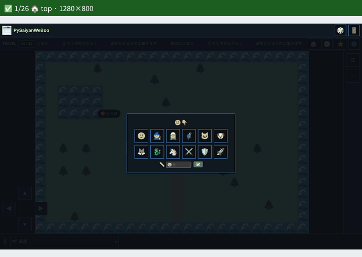

🗓️ 2026-11-07 · 🧭 Chromium 153 · 🐧 Linux · receipt [`docs/evidence/browser.json`](docs/evidence/browser.json) · tested commit is in the receipt

| 🧪 Suite | ✅ | 📝 |
| --- | ---: | --- |
| `tests/integration/school_browser.py` | 18 | |
| `controls_browser.py` | 162 | |
| `layout_presets_browser.py` · `route_table_browser.py` · `source_browser.py` | 5 · 1 · 1 | |
| `plotly_browser.py` | 3 | Plotly.js from npm `plotly.js-dist-min` (CDN unreachable here) |
| `successor_browser.py` | 3 | audio built; PulseAudio null sink |
| `tests/integration/test_gradio_dom.py` | 1 | BrowserTestKit main instead of the pinned commit |
| BrowserTestKit `platform_probe` × 17 adapters | 34 | Chromium desktop + Pixel |
| 🎞️ evidence GIF shots | 24 | |

🗂️ Since 2026-11-13 these suites live in `tests/integration/pages_browser.py` (controls, layout presets, route table, source, plotly) and `flutter_browser.py` (successor); the school suite moved to the portfolio with the world (`tests/world_browser.py`).

🚫 Firefox / WebKit not installed here, so only the Chromium lanes ran.

🔁 Re-record:

```sh
python3 -S pysaiyanweboo.py --site build/site
uv run --project ../BrowserTestKit --group pages --group browser python ../BrowserTestKit/tools/evidence_gif.py docs/evidence/browser.gif --serve build/site --plan docs/evidence/browser.json
```

## Visual regression

The deterministic Chromium screenshot lane now also runs
`tools/check_visual_regression.py`.

The rollout is intentionally two-stage:

1. candidate mode: screenshots are validated as PNGs and compared when a reviewed
   baseline exists;
2. enforcement mode: `--require-baseline` can be enabled once all stable
   contract fixtures have reviewed baselines.

Baseline updates are reviewed UI changes, not automatic CI output.

The checker requires an existing candidate directory and emits an explicit
setup error if no PNGs match the configured pattern. By default it considers
`web-ui-*.png`; `--pattern` can narrow enforcement to stable contract
fixtures before examples/gallery captures become blocking.

CI currently runs the checker with Python 3.15. The script uses Python 3.9+
built-in generic type syntax such as `tuple[int, int]`.

## Roadmap

- expand the component gallery
- consolidate Ironmate metadata-only discovery in the portfolio; retain working consumer demos
- add API/MCP Stub patterns without moving domain logic into PySaiyanWeBoo
- expand themes beyond Modern and GitHub-like
- keep HTML contract v1 stable while `markdown.py` and `ascii_artist` integrations adopt it

The bootstrap work was tracked in #1 (closed).


## Development tooling

Browser/UI verification keeps two separate lanes: deterministic Playwright/Chromium smoke tests and optional Stagehand v4 agent-oriented experiments. Git/gh and Python tool versions are captured as advisory CI metadata. Repository identity comes only from the pinned canonical Python producer, in separate JSON/JSONL artifacts. See [TOOLING.md](./TOOLING.md).

## Shared screenshot checks

CI checks all six named Chromium desktop/mobile PNGs with BrowserTestKit at
`9d3183ab9244c763be519ee18ca513205c4d3374`, checked out separately in the screenshot job.
See the [shared screenshot guide](https://github.com/myon-bioinformatics/BrowserTestKit/blob/9d3183ab9244c763be519ee18ca513205c4d3374/docs/screenshot-evidence.md).
The shared structural PNG checks supplement the existing local candidate/baseline
comparison. Missing/invalid required captures fail CI; available PNGs are uploaded
even after failure (14 days). This lane does not measure Firefox/WebKit; image validity does not establish semantic correctness.

The screenshot lane now seals a current-run multi-image receipt via pinned
BrowserTestKit, requires all six PNGs and their recorded SHA-256/size, and
checks the explicit tested head SHA plus run ID/attempt. Output is cleared before
capture. Failed receipts are preserved but cannot cover required success. CI also
mutates isolated copies of the real bundle to prove rejection of missing images,
wrong hashes, stale run IDs and failed receipts. These are integrity/run checks;
they add no screen-content or pixel-regression assertions.

Public source placement and automatic Python CI updates: [vendor automation](docs/vendor-automation.md).

## Platform differences: what is claimed, and where it is checked

Python and JavaScript run everywhere; what differs is the engine, the device and the input. The doctrine is BrowserTestKit's (`docs/platform-doctrine.md`), applied here:

- **Layer 1, the rules**: Python is the reference and the page's module gives identical answers (Chromium compares them on seeded fuzz; a one-character change in a rule fails a test).
  Engine and OS do not enter, so this layer is the same everywhere by construction.
- **Layer 2, the page in an engine**: the photo studio's page tests (upright pixels equal Pillow, drawing, history, export, import outcomes) and BrowserTestKit's probe
  (`python pysaiyanweboo.py --btk-adapter list`, one `btk-platform-adapter/1` per page that has state, built from Python; key elements fit without overflow, overlap or clipping at
  320-1280 px and a real click or tap changes what the page promises). `.github/workflows/platform-matrix.yml` runs both on Chromium, Firefox, WebKit, a Pixel 7 profile and an
  iPhone 13 profile on Linux runners and keeps each engine's own decode report (`Check this browser`) as an artifact. Chromium and its Pixel profile also run locally.
- **Layer 3, a real device**: not run. Pixel and iPhone profiles are emulation; Playwright's WebKit is not Safari. iOS Safari (HEIC, camera, Share, `download`, the paste bubble)
  is **not verified** until the page's JSON is kept from a device. Nothing here says otherwise.

Running the probe against the local pages: `python -S pysaiyanweboo.py --site build/site`, serve it on port 8000, then
`python -S pysaiyanweboo.py --btk-adapter web-ui-photo-studio > adapter.json` and `python BrowserTestKit/tools/platform_probe.py collect --browser chromium --profile pixel --adapter adapter.json
--widths 320 384 --out out`. It found a real defect while this was written: the showcase title was clipped at 320 px (it now wraps). The examples are generated, not published, so the probe
uses `http://127.0.0.1:8000/examples/...` (`--url` overrides it); the page viewer for multi-browser captures needs https pages and stays Flutter-only for now.

## Multi-browser captures of Flutter pages

`pysaiyanweboo.EXAMPLES["flutter-pages"]` (`--example flutter-pages`) lists the representative flutter_navigation_basic pages by emoji
(route table + published URL), and `tools/capture_matrix.py` turns BrowserTestKit captures and
Ironmate's comparison sheet into a static viewer opened by emoji. See [capture matrix](docs/capture-matrix.md).
Its tile layout switches live between presets (8px grid, compact, device width, wide); see [layout presets](docs/layout-presets.md)
for the JSON, the CSS generator (Python; Node reaches it through `vendor/py_launch.cjs`) and the sweep that lists every preset that holds.

## Python static wrapper

`pysaiyanweboo.py` is a portable, stdlib-only HTML emitter. Standalone users copy the
file from GitHub and run that copy with Python 3.10+. The copy accepts text or
explicitly authored HTML and CSS, and it needs no npm, Deno, browser, or
installed package. The repository root is also an installable project for
Python 3.11 or newer, with no third-party runtime dependencies, so
`uv pip install` of the git URL installs the same module. Layout output is
meant for Python/`pytest` one-liners. JavaScript is omitted by default; shared
modules may be linked explicitly. `run_node()` wraps existing Node checks for
the same pytest lane.

```sh
python -S -c 'from pysaiyanweboo import render_document; print(render_document("Hello"))'
printf 'Hello <world>' | python -S pysaiyanweboo.py --title Demo > demo.html
printf '<main class="ui-page">Demo</main>' | python -S pysaiyanweboo.py --trusted-html --css palette.css > demo.html
printf 'Result' | python -S pysaiyanweboo.py --css-bundle --theme github-like > demo.html
printf 'Result' | python -S pysaiyanweboo.py --asset-base . --with-scripts ui.js > demo.html
```

The first examples escape input as text. `--trusted-html` and `--css` accept
caller-authored source, not untrusted content; this wrapper is not a sanitizer.
Embedded CSS (`--css-bundle`, or `--css FILE`) produces a self-contained document when the supplied
HTML/CSS have no external references; there are no shared stylesheet links to copy or pin.
`--with-scripts` requires a **local** `--asset-base` and emits module `src`
links only. `shared_scripts()` and direct `render_document(scripts=...)` both
reject remote URLs (including HTTPS), query/fragment and ambiguous path syntax.
Consumers must vendor and verify exact-version modules and manage their serving
and imports; the wrapper checks path syntax, not file identity. Authored
`trusted_html` is outside this link policy. See [the JS contract](docs/lightweight-js.md).

```python
from pysaiyanweboo import bundled_css, render_document, run_node, shared_scripts
print(render_document("Hello", title="Demo", css=bundled_css()))
print(render_document("Hello", scripts=shared_scripts("./vendor/web-ui")))
assert run_node("-e", "console.log(1 + 1)").stdout == "2\n"   # Node 26+; a test keeps its Node side as a Python string
# Caller-supplied CSS can also be passed directly: render_document("Hello", css="body {color:#000}")
```

Existing `ui.js` text/clipboard helpers and
`repository-diagnostics.js` rendering remain in use by examples or consumers.

📋 `pysaiyanweboo.table(headers, rows, caption=…, row_classes=…)` renders a `.ui-table` (escaped cells; `trusted_html=True` for
cells that are already HTML). Consumers' report pages (BrowserTestKit's platform matrix and app digest, markdown's
real-world report, ascii_artist's captures) build on `render_document` + `core_css()` + this instead of their own CSS.
`core_css(theme="modern")` is the ~4 KB bundle (tokens, base, components, one theme) for such pages; `bundled_css()` is every
stylesheet. The status classes `ui-pass` / `ui-fail` / `ui-changed` style any element, including a `.ui-tag` badge.
`core_css("terminal")` is the dark monospace terminal look (palette in tokens.css, `# ` titles / `[tags]` / `> ` buttons in
`themes/terminal.css`) that mcp-toolcall-lab's stub pages use instead of a stylesheet of their own. A consumer with a brand
palette registers it as `theme_css("ironmate", {"--ui-bg": …})` next to `core_css()` and renders with `theme="ironmate"`.
A page whose forms are plain `<button>` / `<input>` / `<select>` / `<textarea>` / `<table>` elements (hand-written or
built by its own script) opts them into the component look with `class="ui-elements"` on `<body>` or a container.

📦 A consumer ships one committed stylesheet: `pysaiyanweboo.write_bundle("static/site.css", theme="terminal", brand=("acme", tokens),
extra_css=LAYOUT)` writes `core_css` + the brand palette + the consumer's own layout rules under a one-line provenance header
(`web-ui-bundle/1 commit=… sha256=…`), and `check_bundle(...)` with the same arguments lists why it is stale (moved pin, hand
edit, changed layout) — a two-line test per repository. The same from the shell or Node: `python -S pysaiyanweboo.py --bundle FILE
--theme terminal --brand brand.json --extra-css layout.css` / `--bundle-check FILE`. `source_commit()` is the commit the
installed module came from (pip's install record, or the checkout's HEAD).
Before a brand palette ships, `check_theme(tokens)` lists every text token that misses WCAG AA (4.5) on `--ui-bg` or
`--ui-panel` and a border that would vanish; `theme_palette(hue, dark=…)` builds a palette from one hue that passes by
construction. CLI: `python -S pysaiyanweboo.py --check-theme brand.json`.
Every rendered page carries `<meta name="generator" content="web_ui <commit>">` (`generator_meta()`; the installed commit, `checkout` in a checkout), so a screenshot or a
GIF receipt says which PySaiyanWeBoo commit drew it; BrowserTestKit's `evidence_gif.py` records it as `generator`.
Layout is a preset too: the core reads `--ui-text` / `--ui-space` / `--ui-max`, `EXAMPLES["page-layouts"]` names four
(comfortable, compact, wide, device; 8 px spacing grid) and `write_bundle(..., layouts=spec)` + `layout_switch_html(spec)`
make them switchable without a reload — people and Playwright try each, and the [sweep](docs/layout-presets.md) keeps every
one that holds as a candidate.
📄 A whole page from data: `page_document(spec)` renders a `web-ui-page/1` JSON — title, description, icon and blocks
(`heading`, `text`, `output`, `table`, `card`, `section`, `links`, `image`, `kv`, `badges`, 🗂️ `tabs` — 2..8 `{label, blocks}` switched by radios with no script, e.g. 🎞 GIF demo / 🧩 features — and 🔬 `runbook`, below) — as one self-contained page,
every string escaped and every link relative or HTTPS, with a brand theme (`theme_css`) and switchable layouts
(`layouts=`). `python -S pysaiyanweboo.py --example page` prints a spec; `--page spec.json [--brand brand.json --layouts
page-layouts.json]` renders it from the shell or Node, so a report script owns only its data. 🏠 `--repository OWNER/REPO`
puts the way back first (🏠 portfolio · 🐙 GitHub); `add_back_nav(page, "OWNER/REPO")` gives a page built some other way the same nav.
📲 `--home-screen DIR` (`home_screen(spec, DIR)`) makes the spec's icon into square, opaque `icon-180/192/512.png` and a `manifest.webmanifest` next to the page, and writes the spec back with `home` — the short name, the source's SHA-256 and each size as Base64 (a cache Python reads without decoding again) — so "Add to Home Screen" and shortcuts show the repository's own icon (iOS: `apple-touch-icon` 180 · Android / desktop: the manifest). No Pillow: nearest-neighbour scaling keeps pixel icons crisp.

🧰 With the way back, `--repository` now gives the page the header, side and foot every page of the site carries, so a repository's
guide looks and moves like the portfolio's pages: 📟 a board that says what the page is (its description, else a line any page can
carry) and where the links lead, 🫧 the round face that follows the pointer, 🏠 (the first link) and the other links by their emoji,
⭐ ⚙️, ☰ the page's own sections, ⋯, and as the foot 🚪 the links and 📌 this page with 📦 its size. ⭐, 🌐 and 🎨 are kept per origin, so
the guides and the portfolio share them. `add_back_nav(page, back, chrome=True)` and `add_site_chrome(page, links, title="GUIDE")` give
them to a page built some other way; a page that has them keeps them, and without `chrome` the page is what it was.

⚙️ holds what every page shares: ⏯️ stop the board, 🌐 the language (11), 🎨 the colors (the page's own, or one of the themes for
every page of the origin), then the rows a page adds (another layout, a mode). 🌐 changes every word these parts put on the page —
the chrome's tooltips, the board's "in N min", 🫧, the foot's 🚪 and 📦, the way back's ポートフォリオ and GitHub リポジトリ (catalogue
words, found by their words) and the stand-in line of a page that says nothing of itself — and every word this module writes into the page's
own body, found by its words (a format such as `⌨️ x.py · 全 3 コマンド` by its shape): a runbook's labels, states, 🤖 and copy messages,
🧩 the full list's titles and headers, and the tabs and headings every guide shares (🧩 機能一覧 🔬 検証ガイド 🎞 GIF デモ 🔗 リンク 📥 取得
▶️ 実行 🐍 Python から呼ぶ). A page carries only the words it holds (`add_part` keeps them, whoever adds the chrome). A site's own names
join them through the chrome's `words` (`{"GIF工房": ["GIF studio", …]}`, the ten other languages in order): on the board, in ☰ and 🚪,
on a card, alone or with an emoji or an arrow around them.
`shell_js(words, page)` is the script a world's shell and the chrome share (the catalogue, 🌐 `addWords` `sayIn` `sayAround`, the
board, the menus, the cache): `chrome.js` builds on it, and a world's script starts with it, so a word is written once. The page's own words stay as written (the browser's own translate
reads them) and `<html lang>` says their language (`page_language`). A door relabels its pull-down; a page of its own hears `ui-lang`
on `document`. The browser tests switch all eleven languages and fail on any word of these parts left behind, on the chrome and on a
guide with a runbook and the full list.

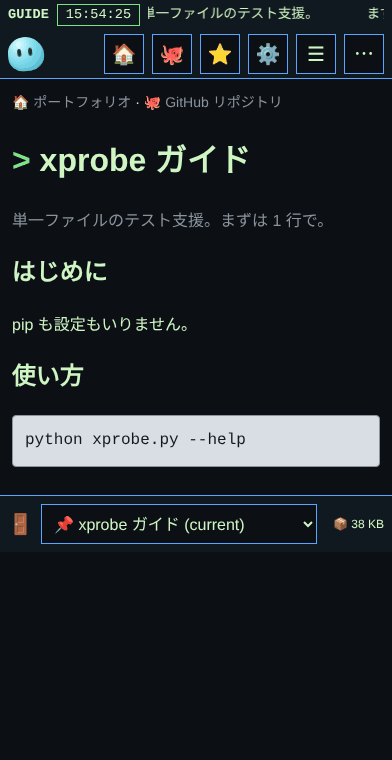
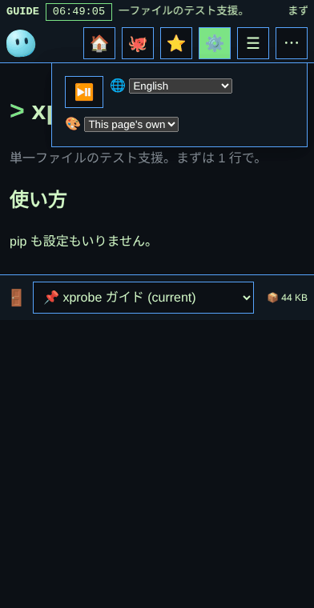

🧩 `--features FILE` (`add_features(spec, FILE)`, repeatable) puts the full list at the top of the 🧩 機能一覧 tab — one tab, above the hand-written highlights: ⌨️ every argparse command with its help and options (the file runs only up to its first `parse_args`, nothing after it) and 🐍 every name in `__all__` — or, without it, each public function and class — with the first line of its docstring (read without importing). The list comes from the code at build time, so it never misses a command or a function; a hand-written 🧩 機能一覧 that already names everything gets no full list, each file keeps its own sections (titled with its name and 全 N: several `--features` add up in order, a second run replaces only that file's, in place), and a file that cannot start keeps its 🐍 list.

For an explicit inventory, run `--page docs/guide.page.json --features-config docs/guide.features.json` from the checkout root. Give the config a JSON array of source objects. This example includes the root parser, a dispatched command, a wrapper backed by a separate API source, and an API-only source.

```json
[
  {"source": "example.py", "cli": [[], ["share"]], "namespaces": true},
  {"source": "pkg/graphs.py", "entry": "tools/graphs.py", "cli": [[]]},
  {"source": "pkg/readers.py"}
]
```

Omit `cli` for an API-only source. `namespaces` includes public members declared as keyword arguments to `SimpleNamespace`. CLI probes stop before argparse consumes arguments. Keep parser setup independent of command execution, and make any dependencies needed to reach the parser available in the renderer's environment. A missing parser, startup failure, or timeout fails an explicitly configured build. The single-file `--features` mode can still show the API when its CLI cannot start.

🎞️ `gif.js` (`UiGif`) turns canvas frames into one animated GIF89a with no dependency: the browser decodes, resizes, zooms and
captions the images it is given (`Composer`), and the module adds only what browsers lack — a bucket histogram while frames arrive,
one global palette (exact for at most 255 distinct RGB colours when the selected palette fits them, else bucket median cut + refinement), each frame as its tight changed rectangle (transparent where
unchanged when that is smaller), 12-bit LZW, delays ≥ 2 cs on the real timeline, and a byte budget (`maxBytes`: fewer colours, then
fewer burst frames). RGB changes are compared before quantization; input alpha is ignored, so composite onto the desired
background first. Exact colours are not promised when a smaller palette or budget requires quantization. Delays use centiseconds,
rounded on the timeline with a 20 ms minimum per displayed state; shorter inputs can lengthen playback. Holds over 655350 ms
split into repeated GIF images without losing duration (`report.frames` counts these physical images).
`maxBytes` is a best-effort encoded-byte target, not a memory limit or hard output cap: colours halve down to 16 (or start lower
if requested), then grouped bursts keep every 2nd, 4th or 8th state plus their endpoints. Dropped states donate their time to
retained states. If none fits, the smallest attempt is returned with `report.overBudget: true`; callers requiring a hard cap must
check that flag before saving. Timing continuation images also count toward this budget. Non-finite or unsafe-integer centisecond durations are rejected;
very long finite recordings can still require substantial memory and output.
`gif_recorder_document()` is the blank page a browser driver opens to use it — screenshots go in once, the GIF
comes out once; BrowserTestKit's `evidence_gif.py` is that driver. The encoder (`UiGif.Encoder`) also runs in Node from the file
`--site` writes; `tests/test_media.py` runs it in Node and reads every GIF back in Python (its own block walk, Pillow's LZW), `GifBrowserTests` in each engine with Pillow.

🎞 `gif_maker_html()` is the same encoder for people: 📂 pick images → 📐 size / ⏱ delay / 🏷 file-name captions → ▶ one looping GIF
in the page → ⬇ save; nothing leaves the browser (gif.js's `UiGif.bindMaker` binds it). `gif_maker_document()` is a page of one
(the portfolio's 🎞 GIF工房). 📱 `home_label(page, label, icon=, touch_icon=)` names any page's home-screen shortcut (a long title
is cut off under the icon) and swaps its icons, for pages other generators made.

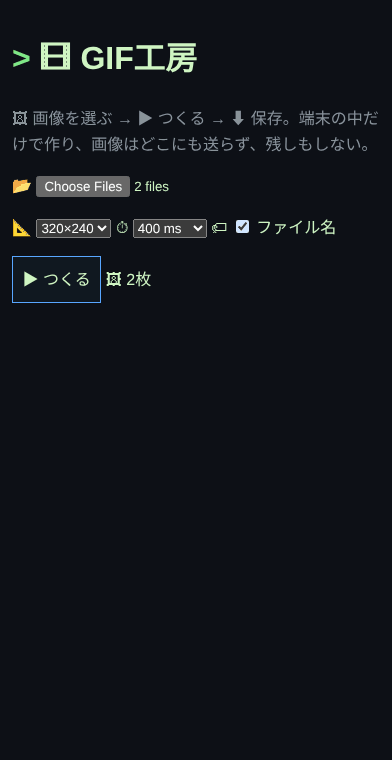

🧩 `parts_document()` (`examples/parts.html`, `--parts`) is the regression baseline: every block of the `page` example under every
theme (`PARTS_THEMES`, plus a `--brand`), each in its own sandboxed frame with the layout radios inside. BrowserTestKit
records it in this repository's GIF evidence; a consumer compares its own page against the frame that uses its theme.

The core also carries `@media print` (white page, `.ui-no-print` / `.ui-print-only`), `prefers-reduced-motion` (animations and
transitions off) and `theme="auto"` (the dark modern palette, or github-like when the browser prefers light).

🩺 The repository-diagnostics page itself is one function: `pysaiyanweboo.repository_diagnostics_page("owner/repo")`
returns the self-contained HTML (bundled CSS and `repository-diagnostics.js` embedded, nothing from a CDN) that
reads `./repository-diagnostics.json` next to it via `RepositoryDiagnostics.mount`. Consumers (markdown,
ascii_artist, mcp-toolcall-lab) write their own JSON/JSONL with gh_identity and call this for the page, pinning
this repository as a git dependency (`uv lock --upgrade-package pysaiyanweboo` to move the pin).
They remain optional browser utilities under the lightweight JS bar in
[docs/lightweight-js.md](docs/lightweight-js.md). Python cannot replace
browser-side interaction merely by generating HTML. Live DOM checks of published
pages stay on an agent `/js` lane documented there. The wrapper preserves the v1
classes and theme attributes without changing those existing assets.

See [Pages ownership and execution](docs/pages-ownership.md) for the separation
between static discovery and execution evidence.

### Single-file embedded ES modules (experimental)

The browser modules (`ui.js` and the rest) are Python data inside `pysaiyanweboo.py`; `python -S pysaiyanweboo.py --site DIR` writes them under `DIR/js/`.
No npm, pip dependencies or runtime download is needed. JavaScript remains opt-in.

```sh
printf 'Hello' | python -S pysaiyanweboo.py --embed-ui > demo.html
python -S -c 'from pysaiyanweboo import render_document; print(render_document("Hello", embedded_modules=("ui.js",)))' > demo.html
```

The output HTML contains the ES module body. The module exports `setText`,
`prettyJson` and `copyText`; embedding it alone does not invoke them.
The same Python file exposes `module_asset("ui.js")`, returning bytes and
`text/javascript; charset=utf-8` for caller-owned HTTP routing. The Python
wrapper does **not** run a web server. To avoid inline code, use
`module_mode="data"` for a base64 data URL, with a CSP that explicitly permits
`data:` scripts. Data URLs do not support relative module imports.

Inline modules need an appropriate CSP nonce or hash (or a relaxed policy).
`module_nonce="..."` supplies a caller-generated nonce;
`module_csp_hash(EMBEDDED_UI_JS)` gives the CSP hash expression.
Do not generate a static, predictable nonce as a security measure.
These modes are not a JS sanitizer: source must be trusted and audited.
Module bodies containing HTML `</script>` terminators are rejected.

**Deployment comparison:** existing local module `src` references require a
separate served JS file; embedded inline/data mode creates one HTML artifact;
`module_asset` allows a single Python source to serve a separate JS response.
CDN dependencies stay a deliberate consumer choice. Local module `scripts=` and
`shared_scripts()` still reject remote URLs. Opt in to documented HTTPS classic
scripts with `remote_scripts()` and `render_document(remote_scripts=...)`. See
[docs/lightweight-js.md](docs/lightweight-js.md).

Plotly charts from a figure JSON spec (no Python `plotly` package):

```sh
python -S -c 'from pysaiyanweboo import plotly_figure, render_document, remote_scripts; spec={"data":[{"type":"bar","y":[1,2,3]}]}; print(render_document(trusted_html=plotly_figure(spec), remote_scripts=remote_scripts("plotly.js")))' > chart.html
```

`plotly_figure()` emits the graph div and a trusted inline `Plotly.newPlot`
initializer; `remote_scripts("plotly.js")` links the unpinned plotly.js CDN URL
from the explicit allowlist.

Browser `.pptx` download from a JSON slide spec (no `python-pptx`, no Office
XML in Python). `pptxgenjs` is the pinned PptxGenJS 4.0.1 bundle with SRI.
Each slide is one `items` list; array order is z-order. Center-mode connectors
move to the start of that list so they paint behind later objects. Connectors
are a straight line plus an unfilled triangle arrowhead, not the built-in
arrow connector. Generated text, shapes, lines, arrowheads, and tables default
to black `000000` text and borders, no fill, and `fontFace` `Meiryo` (メイリオ).
Spec values for those properties override the defaults. Layouts beyond that
stay in the caller spec.

```sh
python -S -c 'from pysaiyanweboo import pptx_presentation, render_document, remote_scripts; spec={"slides":[{"items":[{"kind":"text","text":"Hello","x":0.5,"y":0.5,"w":4,"h":0.6}]}]}; print(render_document(trusted_html=pptx_presentation(spec), remote_scripts=remote_scripts("pptxgenjs")))' > deck.html
```

See [docs/lightweight-js.md](docs/lightweight-js.md) for the slide spec,
`pptx_connector()`, and the edge/center arrow convention.

Run `python -m unittest tests.test_embedded_modules -v` or `uv run pytest`. Browser
verification should check the resulting module in Chromium under the chosen CSP;
unit tests alone do not establish browser execution.

### Common controls in one line

`button`, `select`, `input_field`, `textarea`, `checkbox`, `badge`, `card`, `details`, and
`section_browser` now emit labeled native controls and components from Python. A local,
explicitly loaded `controls.js` binds section selection to text output; native
controls and disclosure work without JS. See [one-liners and the Markdown
boundary](docs/python-controls.md).

### Components from Python, in this repository or another

`COMPONENTS` names every component that has an HTML builder, a stylesheet and a module (`dial`, `seed-dial`, `seed-roll`, `theme-switch`, `labels-switch`, `toolbar`, `coordinates`,
`door`, `playground`, `report`, `mcp`, `screens`, `patterns`, `imagestudio`, `shelf`, `tempclip`, `photo`, `studio`, `source`, `chat`, `curl`, `showcase`,
`front`, `repository-diagnostics`, `table`, `steps`, `scroll`, `stage`, `status`, `pager`, `chrome`, `tabs`; `components()` lists them as data), and two calls wrap them:

```python
import pysaiyanweboo                            # in another repository: pinned by commit in pyproject.toml (uv)
parts = pysaiyanweboo.component_parts("dial", "volume", maximum=11, label="Volume")   # {"html", "css", "js"}: place them where your page wants them
page = pysaiyanweboo.component_document("dial", "volume", maximum=11, document_title="Volume")  # or one single-file page: bundled_css() + the stylesheet, the HTML, the module inline
```

`parts["css"]` is what the component needs beyond `bundled_css()`; `parts["js"]` is the module source, which binds its own elements when the page loads it
(`[data-ui-dial]`, `[data-ui-door]`, …), so a page lists it once with `module_script()` or `render_document(embedded_modules=...)`. A spec goes first for the
components that take one (`door`, `source`, `showcase`); keyword arguments reach the builder (`heading_level=`, a dial's `minimum=`/`maximum=`/`step=`).
From Node or a shell, the same calls by name: `python -S pysaiyanweboo.py --component dial --set name=volume --set maximum=11 --part json` prints the three as
JSON (`--part page|html|css|js|json`, `--spec FILE` or `--spec -` for a spec, `--set KEY=VALUE` with JSON values, `--component list` for the table);
from Node, `require("./vendor/py_launch.cjs").run("vendor/pysaiyanweboo.py", ["--component", ...], {noSite: true}).stdout`.

💬 `chat` is a log of bubbles, a box that sends on Enter (Shift+Enter: a new line; never while an IME composes), chips that send their text and 😀＋ emoji
reactions on every bubble. The answer is the page's own: `webUiChat.bindChat(document, {respond})[0]` gives the controller (`say`, `bubble`, `ready`,
`status`, `react`), and `respond(text, reply)` returns trusted HTML or writes through `reply.text()` / `reply.html()` while it streams. Reactions stay in
the page (`chat_react` in Python is the rule, `chatReact` in chat.js its twin) and every change is a `ui-chat-react` event, for a relay to share.
🔗 `chat_html(share=True)`: your bubbles get 🔗, which puts the link to that message in the address bar and on the clipboard (✅, or 📋 where copying is
refused) with a `ui-chat-link` event, and a page opened as `chat_link("chat.html", "/onto ギター")` (`chat.html#%2Fonto%20…`, `chatLink` in chat.js) sends
the message once, when the bot is in (`ready()` with a `respond`).

🧩 `add_part(page, parts, at="top" | "bottom", scope=".root")` puts a component on a page that is already built: the HTML after `<body>` or at its end,
the stylesheet in `<head>`, the module last, once (run it twice, it is added once). A page that does not carry this module's tokens (another repository's
own sheet) gets them under `scope`, with the rules out of `@layer` so its own plain rules do not outrank them; a page whose Content-Security-Policy lists
its scripts or styles without `'unsafe-inline'` gets the two hashes added to that list, nothing wider.

| | |
|---|---|
| 🧰 `chrome` | `chrome_html({"id", "lang", "board", "home", "places", "tools", "settings", "screen"})`: the header and side of a page that is not a world. 📟 a board (title, a scrolling line, the clock `hh:mm:ss`, "in N min"), 🏠, ⭐ starred places of every page that shares the id, ⚙️ (⏯️ stops the board, 🌐 every word the chrome brings in 11 languages, 🎨 the colors), ☰ this page (itself 📍, its `h2`, the rows it gives), ⋯ (⬆️ ⬇️) and up to 8 emoji of the page's own (`href`, `links`, `body`, in the head or the side). A row is `{label, href}`, `{label, key}` or `{label, key, options}`: a key row is an action, the chrome sends `ui-chrome-action` (`detail.key`) and the page answers, so one 💾 can offer every format it saves; an `options` row is a pull-down beside 🌐 and 🎨 (`detail.value` too; the page sets `[data-chrome-choice=key]` to what is in effect, such as a notation); a page declares its rows once (`chrome_rows_script`, read by `chrome_rows_of`) and a host places them with `chrome_hosting(spec, page, views)`: its own rows from the start, and on a screen of panels each view's rows while it shows (`ui-chrome-view` with the panel or the framed document, which also gets its keys), hiding what they `replaces`; a view that holds PySaiyanWeBoo's 💻 ⇄ 📱 switch gets its ⋯ row without declaring it, and a framed view follows ⚙️ 🎨; `settings` and `screen` are rows the page adds to ⚙️ (another layout, a mode) and ⋯ (a temporary shelf). ⭐ and 🌐 are kept in this browser; nothing is sent |
| 🧰 `views` | `views_html([{"source", "document", "name", "title", "about", "framed", "repository"}, …], at="tools/index.html", site=…, home={"title", "heading", "about"}, reserved=…)`: one page of many views. 🏠 `#home` lists them, `#name` shows one, `#section` opens the view that holds it. A view is an inert `<template>` until first opened, then its scripts run in the page's order; links are rebased from where each document was written (`source`) to the page (`at`). `framed` runs an app that owns its document (its CSP, its ids) in an `<iframe srcdoc>`: its files load from the site's root, its #links stay in it, its links to the page's views open them. The tab shows the view's title, 🚪 points at it, 📟 the board says what it is (`about`), the chrome hears which view shows (`ui-chrome-view`). 🆔 One owner per id: a joined view that shares one stops the build, unless it names its `repository` (⏸ in its place). The host hears `ui-view-frame` {name, frame} when a framed view loads and moves with `uiViews.show(view)`. |
| 🗂️ `tabs` | `tabs_html([(label, html), …], id="profile")`: 2..8 tabs with no script (radio inputs and labels). A panel's animations start each time it is shown, so a bar can grow on its own when its tab opens. The page spec's `tabs` block is the same markup; a page that links its own sheets adds `tabs_css()` |

```python
page = pysaiyanweboo.add_part(page, pysaiyanweboo.component_parts("chrome", {"home": "../../index.html#tools", "board": {"title": "TOOLS", "items": [{"text": "🎞 GIF"}]}}), at="top", scope=".ui-chrome")
page = pysaiyanweboo.add_part(page, pysaiyanweboo.component_parts("door", door, foot=True, links=[{"emoji": "🐦", "label": "X", "href": "https://x.com/me"}], size=True), scope=".ui-door-foot")
page = pysaiyanweboo.stamp_page_size(page)
```

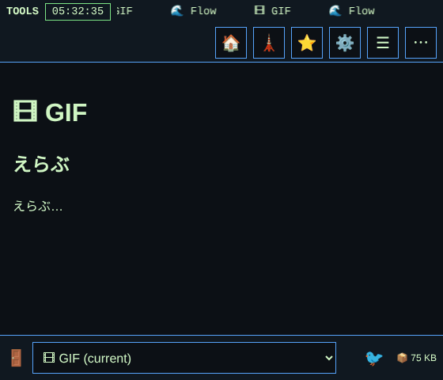

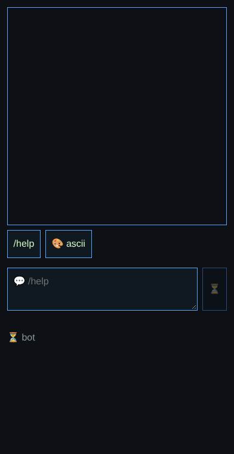
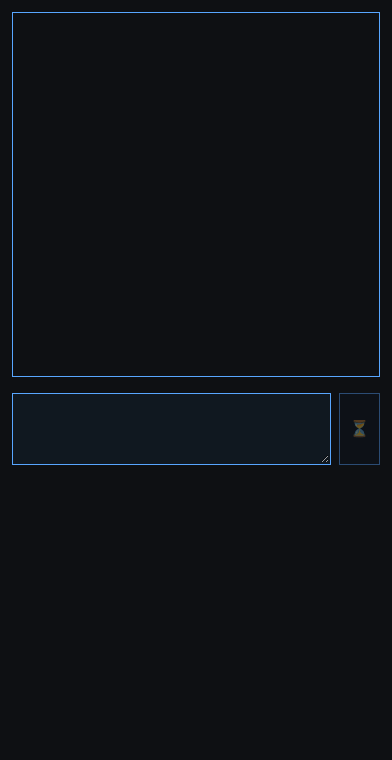
`css_source(name)` and `js_source(name)` stay the raw sources by file name; `write_js()` still writes the modules out for pages that link files (`python -S pysaiyanweboo.py --css-bundle` the stylesheets).
mcp-toolcall-lab is the model consumer: it vendors `pysaiyanweboo.py` through the parent repository's `vendor_sync.py` (`vendor-consumers.json`, `vendor.lock.json`)
and builds its Pokémon panel from `source_panel_html(spec)` + `css_source("source.css")` + `js_source("source.js")`; `component_parts("source", spec)` is the
same three in one call. `tests/test_pages.py` renders every entry.

`repository-diagnostics` is `repository_diagnostics_page()`'s body (`repository_diagnostics_body()`, the page ascii_artist, markdown and
mcp-toolcall-lab each wrote by hand; markdown already calls the page). `repository-diagnostics.js` stays a classic script (`"classic": true` in the
table, so `component_document()` inlines `<script>`, not a module) and the mount line is `RepositoryDiagnostics.mount(document, "./repository-diagnostics.json")`:
one `no-store` GET fills `#metadata`, `#summary` and one escaped card per observation (a link only for an `https://` URL), and a failed GET says
"Diagnostics could not be loaded."

`table` is the report table Ironmate (`browser_matrix.py`, `image_digest.py`), markdown (`real_world_pages_report.py`) and BrowserTestKit
(`app_digest.py`) each build by hand, and the one the showcase sections already used: `table_html({"columns", "rows", "caption", "row_headers",
"missing"})` is `table()` (the one table renderer, `.ui-table`) from a JSON spec, in its own horizontal scroller, no script; `table(headers, rows,
row_headers=, missing=)` takes the same rich cells from Python. A cell is text (line breaks kept), a finite number (right-aligned, `data-num`), `null` (the `missing` text, muted) or
`{text, href, image: {src, alt, width, height}, status, num}`; `status` is a token written as `data-status` for the page to color, hrefs and image
sources are relative paths or http(s) addresses. `python -S pysaiyanweboo.py --component table --spec table.json --part html` from the shell or Node.

`steps` is a runbook (olnm's guide and Component Ops' operations steps had one each, written by hand): `steps_html({"key", "steps": [{id, title,
command, expect, needs, trouble: {seen, check, fix}}], "statuses", "source"})` gives one card per step with its command (📋 `code_block()`,
copied by ui.js's `bindCopy`), what to expect, what it needs and what to check when it fails (`<details>`), and a record kept in this browser
(state, date, actual output, note: records.js drafts under `key:id:field`). The toolbar searches the cards (`filter_input`), filters them by
state (`status_filter`) and saves or loads the records as JSON (`records_io`); the board's `source` (a commit) goes into the file, and a file
from another version comes back with its states reset. States are tokens (`todo`, `pass`, `hold`, `block`) with your labels, coloured by the
theme. A showcase section takes `steps`, `notice` (`notice(text, tone=)`) and `stats` (`stat_tiles`), so a whole operations page, one view per
method or tab, is one `showcase_document(spec)`.

🔬 Any usage guide can have olnm's 検証ガイド: the `runbook` page block (`runbook_html`) is `{"type": "runbook", "books": [{label, intro, runbook}]}`
— one runbook per environment or way to run it — and with two or more, a pulldown (`choice`, default 実行方法, kept in this browser) shows one
at a time. 🧭 olnm's layout is an option: `env` (`{label?, options: [{label, note?}]}`) adds a 環境 pulldown whose note follows it,
`notice` a note beside them, and `layout: "side"` keeps the pulldowns in a sticky column next to the steps (one column on a phone),
coloured by the page's theme like every other guide. 🤖 A step with `"run": true` is one that needs no network or input: `--page guide.page.json --run-steps` (`run_steps(spec, cwd=)`)
runs those with `bash -e -o pipefail -c` before rendering and shows ✅/❌, the exit code, the seconds, the commit, the date, the machine and the real output
(its last 4000 characters) under the step; a failure is shown, not raised, and a step without `run` stays a command to copy.
Use `sed -n '1,8p'` instead of `head -8` to preview lines while consuming the producer's complete output.
Set `expect_stdout_contains` to a nonblank literal fragment to require it in the full UTF-8 stdout of a command that exits 0.
The check is case-sensitive and runs before truncation. For these steps the transcript shows stdout followed by stderr.
The existing `expect` field supplies the displayed example.

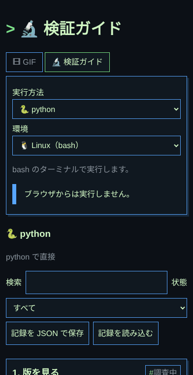
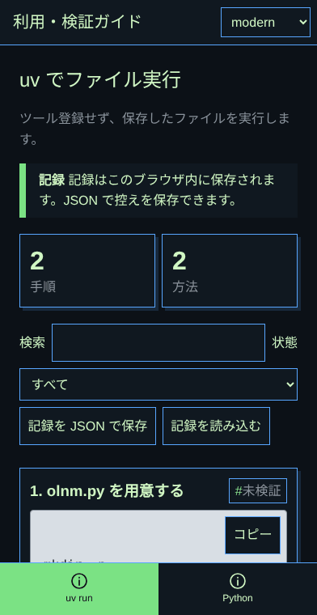

The rest of an operations page is parts too: `page_heading(title, eyebrow=, lead=, chips=[label | (label, href)], stamp={label, value, note})`
(the dated stamp beside a heading, such as the day the evidence was checked; a showcase section takes `eyebrow`, `links` and `stamp`),
`download_json(data, id=, filename=)` (the data the page was built from, carried in the page with every `<` escaped, saved by records.js),
and `row_statuses=` on `table()` / `data_table()` so `status_filter()` narrows table rows as it does runbook cards.

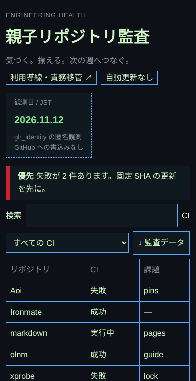

`stage_html(html, label=, ratio=(16, 9), pin=True)` is a fixed display area 🖼️ (a slide's SVG, a canvas, a photo): it keeps its ratio, is
never taller than `--ui-stage-room` (64dvh; a phone on its side: the whole height) and, pinned, stays at the top while what is under it scrolls.
svg, img, canvas and video fill it; other children are overlays the page places. CSS only, no module.
`status_html(text="", tone=, id=)` is one line of news 📣 (what the page just did — pinned, copied, saved — or, with `tone="error"`, what went
wrong): a polite live region (`role="status"`; an error is a `role="alert"` in the danger colour), text never markup, and the line keeps its
height while empty so the page does not jump. Pages write later messages with `textContent` on `[data-ui-status-line]`. CSS only, no module.
`pager_html(count, variant=, words=, wrap=, keys=)` is page controls 🧭 in six variants (`pager_variants()`): `arrows` ⬅️ 1/N ➡️, `ends`
⏮️ ⬅️ 1/N ➡️ ⏭️, the cross-key `dpad` (⬆️ first, ⬇️ last), `dots` (one ● per page), `slider` and `dial` (the dial component). Every variant is
in the markup and `PAGER_PARTS` is the one table of which parts each shows, so setting `data-ui-pager` switches it with no reload. pager.js
sends `ui-pager` ({index, count}); `pagerSet(el, index, count)` follows a change the page made itself (a page added); `pager_index()` is
the same steps in Python. A tap does not take the focus, so a text field being typed in keeps it.

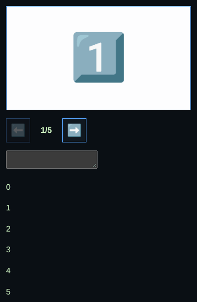

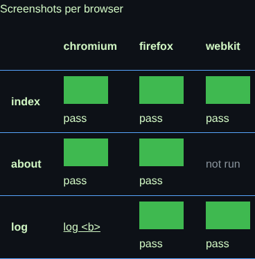

The GIFs come from the browser tests (`PSWB_GIFS=docs/demo python -m pytest tests/integration/pages_browser.py -k "TableBrowserTests or StagePagerBrowserTests"`).
`PSWB_GIFS` takes the recorder's output options too, parsed by the same argparse definitions: `PSWB_GIFS="runs --suffix=-chromium --timestamp --git-commit"`
writes `runs/component-table-chromium-20261108T113412Z-288cbed.gif` (the suffix after the base name, then when the run started, in UTC, and the commit it ran, in the order given), so repeated runs keep every file without `--force`.

### Records boards from Python

`stat_tiles`, `data_table`, `filter_input`, `draft_textarea`, `draft_select`, `records_io` and
`records_board` build a read-only record board (PR / Issue queues, audit tables) from Python
data (`data_table` is `table()` with a required `id`; `row_ids=` puts `data-ui-row` on each row); the optional `records.js` module adds a text filter, browser-local drafts
(`data-ui-draft`, localStorage, best effort) and JSON export/import of those drafts. No fetch
and no HTML from data: GitHub or other observations are gathered by the Python producer.

```bash
python -S -c 'import pysaiyanweboo as PSWB
rows=[("Aoi", "#1", PSWB.badge("失敗")), ("markdown", "#2", PSWB.badge("成功"))]
body=PSWB.stat_tiles((("PR", len(rows)), ("CI失敗", 1)))+PSWB.filter_input("prs", count_id="n")+"<span id=n></span>"+PSWB.data_table(("repo","PR","CI"), rows, id="prs", trusted_cells=True, row_ids=("Aoi#1","markdown#2"))+PSWB.draft_textarea(key="Aoi#1:notes", id="notes", label="メモ")+PSWB.records_io()
print(PSWB.render_document(trusted_html=PSWB.records_board(body), css=PSWB.bundled_css(), scripts=PSWB.shared_scripts(".", names=("records.js",))))' > board.html
python -S pysaiyanweboo.py --site .   # writes js/records.js next to it
```

### 📦📜 A saved state as text (`save_text`, `spell_text`, `bits_pack`)

So a page can go on where it stopped on another device, or after its browser storage is gone. No DOM and no storage: the page decides
what its state is, these turn it into text and back. Python and records.js can read each other's save text. The checksum covers the original JSON bytes.
Numbers must be finite and between −(2⁵³−1) and 2⁵³−1. Use strings for larger exact values rather than rounding them in JavaScript.

| | Python | records.js | for |
|---|---|---|---|
| 📦 | `save_text(state)` / `save_state(text)` | `saveText` / `saveState` | a portable JSON value as one base64url line (copy it, keep it in a file) |
| 📜 | `spell_text(data)` / `spell_bytes(text)` | `spellText` / `spellBytes` | a few bytes as a spell to write down and type back (ふっかつのじゅもん): 64 kana, 6 bits each, lines of 5 7 5 |
| 🧮 | `bits_pack(layout, values)` / `bits_unpack(layout, data)` | `bitsPack` / `bitsUnpack` | whole numbers packed into those few bytes (JSON is too long to type) |

```python
import pysaiyanweboo as PSWB
layout = [("version", 4), ("level", 7), ("gold", 16), ("hp", 10), ("mp", 10), ("items", 24), ("flags", 25)]   # 96 bits: 12 bytes
spell = PSWB.spell_text(PSWB.bits_pack(layout, {"version": 1, "level": 12, "gold": 3456, "hp": 87, "mp": 30, "items": 45, "flags": 126991}))
# ういむつむ ふあうぐえごあ あかるいび
# あび                                           19 kana
PSWB.bits_unpack(layout, PSWB.spell_bytes("ウイムツム ふあうぐえごあ あかるいび あび"))["gold"]   # 3456 (katakana and any spacing read too)
PSWB.save_state(PSWB.save_text({"schema": "world-save/1", "bag": ["🍠"]}))                    # the whole state, as it was
```

Both texts start with a 16-bit check (CRC-16/CCITT-FALSE), so a spell with one wrong kana or two swapped neighbours is never read
(`ValueError("じゅもんが ちがいます")`), nor a save line that was cut. The kana leave out を ん and the small ones; put a version first in
the layout, so a later layout can still read an old spell.

**📜 kinds: 64, 128 or 4096 characters.** `spell_text(data, kinds)` / `spell_bytes(text, kinds)` (`spellText` / `spellBytes`) draw from
one of three sets, each holding the one before. 64 is the spell above and stays as it is, so a spell written before still reads.

| `kinds` | characters | a character carries | 12 bytes | an 11.7 KB JSON | for |
|---|---|---|---|---|---|
| — (the line) | A–Z a–z 0–9 - _ | 6 bits, 1 byte | — | 15,570 | files, URLs (the fewest bytes for short states) |
| 64 | hiragana | 6 bits, 3 bytes | 19 | 4,616 | writing down and typing back |
| 128 | + を ん, katakana, A–Z | 7 bits | 17 | 3,957 | a little shorter to read |
| 4096 | + JIS kanji | 12 bits, 3 bytes | 10 | 2,309 | pasting: notes, a user dictionary, the browser's storage |

```python
data = PSWB.spell_bytes(spell)   # the 12 bytes of the spell above
PSWB.spell_text(data, 128)     # けヨだあに ヨSああぬをみ あびちのを             17 characters
PSWB.spell_text(data, 4096)    # 越碍わ擢あ ホみた唖搭                           10
text = PSWB.save_text({"schema": "world-save/1", "bag": ["🍠"] * 40}, 4096)   # the whole state as kanji: its JSON, deflated when that is shorter
PSWB.save_state(text, 4096)                                                   # … as it was
```

`save_text(state, kinds)` / `save_state(text, kinds)` write the state as such a spell: 0 and the JSON, or 1 and it deflated — which is
what makes a long JSON short (the line itself is not deflated, and stays as it was). In records.js `saveText(state, kinds)` and
`saveState(text, kinds)` are then Promises (browsers deflate asynchronously); without `kinds` they return at once, as before. The 128
add を ん, the katakana no hiragana looks like (no ウ カ キ セ ヘ モ ヤ リ ヲ ン) and A–Z; the 4096 add the first 3968 JIS X 0208 kanji in
their own order, which every Japanese font has (no table: both languages make them from EUC-JP). A spell of 128 or 4096 is the bytes,
the check and a 1, so its end is known: one wrong character or two swapped neighbours never pass in 128 either; any other change
(and any in 4096, which is for pasting) passes once in 65,536. Not for secrets: whoever has the text has the state.

## Focused test discovery

See [standard-library discovery commands](TOOLING.md#focused-standard-library-test-discovery) for
validated `python -S -m unittest discover` recipes, filename/name filtering,
and the boundary with the full pytest suite.


### 運用ビューの状態

手順カードと状態フィルタは共通の `STEP_STATUSES` を使用します。`todo=調査中`、`doing=着手中`、`pass=完了`、`hold=保留`、`block=ブロッカー` の5種類です。従来JSONの4つのトークンと保存キーは維持し、版が違う記録の状態リセットも維持します。GitHubのopen/closedやCI結果とは別の利用者の作業状態です。
